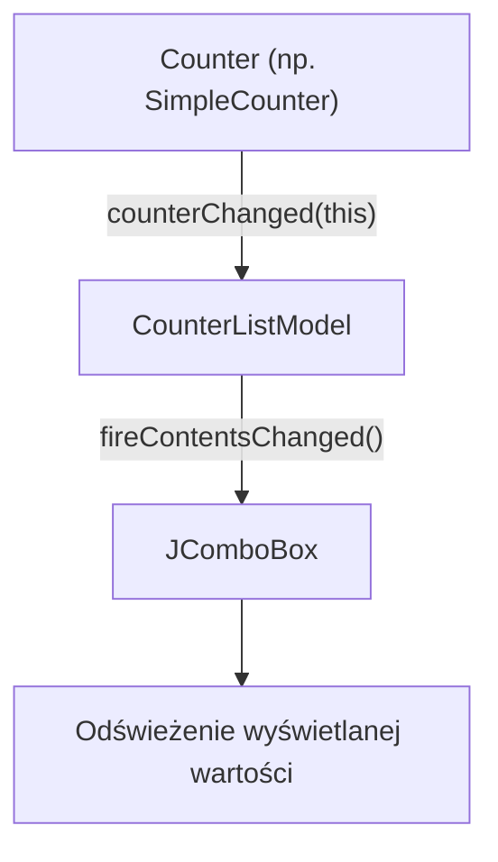

# Obserwator, modyfikatory dostępu
## Program "Licznik"
Podstawą dalszych działań jest program "Licznik". 
Program ten umożliwia korzystanie z trzech rodzajów liczników: 
`SimpleCounter`, `DoubleCounter` oraz `OverflowCounter`.

Podstawę struktury programu stanowi interfejs `Counter`, 
który określa trzy metody: `increase()`, `currentValue()` oraz `reset()`.
Interfejs ten jest implementowany przez abstrakcyjną klasę `AbstractCounter`, 
która zawiera wspólne elementy działania liczników.
Klasa `AbstractCounter` udostępnia gotowe metody `currentValue()` i `reset()`. 
Metoda `increase()` pozostaje abstrakcyjna, 
ponieważ sposób zwiększania wartości zależy od konkretnego rodzaju licznika.

W programie zastosowano również dekorator `Beeping`, 
który implementuje interfejs `Counter`.
Opakowuje on wybrany licznik i rozszerza jego działanie o 
odtwarzanie sygnału dźwiękowego przy każdym zwiększeniu wartości. 
Pozostałe metody przekazuje do opakowanego licznika, 
dzięki czemu można dodać funkcję dźwiękową bez modyfikowania kodu poszczególnych liczników.

## Dekorator Ticking
Dekorator Ticking implementuje interfejs Counter i opakowuje wybrany licznik. 
Udostępnia te same metody co opakowany obiekt: `increase()`, `currentValue()` i `reset()`. 
Metody te przekazują wywołania do opakowanego licznika, 
dzięki czemu dekorator może współpracować z różnymi rodzajami liczników 
bez konieczności zmieniania ich kodu.

Dodatkowo w konstruktorze dekoratora tworzony i uruchamiany jest timer z biblioteki javax.swing.
Otrzymuje on dwa argumenty: 1000, określający odstęp czasu w milisekundach, 
oraz obiekt anonimowej klasy implementującej interfejs ActionListener. 
Klasa ta definiuje metodę actionPerformed(), 
która jest wywoływana przez timer po upływie określonego czasu. 
W jej wnętrzu znajduje się wywołanie increase() obiektu Ticking. 
Następnie metoda ta wywołuje increase() opakowanego licznika, 
zwiększając jego wartość. 
Metoda start() uruchamia timer, 
dzięki czemu cały mechanizm powtarza się cyklicznie co około sekundę.

```java
// dekorator automatycznie zwiększający wartość licznika co sekundę
public class Ticking implements Counter {

    // licznik, który zostanie opakowany dekoratorem
    private Counter myCounter;

    // konstruktor przyjmujący obiekt implementujący interfejs Counter
    public Ticking(Counter passedCounter) {
        this.myCounter = passedCounter;

        // timer wywołuje metodę increase() co 1000 ms, czyli co sekundę
        new Timer(1000, new ActionListener() {
            public void actionPerformed(ActionEvent e) {
                increase();
            }
        }).start();
    }

    // zwiększa wartość opakowanego licznika
    public void increase() {
        myCounter.increase();
    }

    // zwraca aktualną wartość opakowanego licznika
    public int currentValue() {
        return myCounter.currentValue();
    }

    // zeruje opakowany licznik
    public void reset() {
        myCounter.reset();
    }

    // zwraca nazwę licznika z informacją o automatycznym zliczaniu
    @Override
    public String toString() {
        return myCounter.toString() + " (tykający)";
    }
}
```
Etykieta początkowo wyświetla wartość 0. 
Po kliknięciu przycisku „Kliknij!” wywoływana jest metoda increase() licznika, 
a następnie jego aktualna wartość jest pobierana 
za pomocą metody currentValue().

Licznik zwiększa swoją wartość również automatycznie co sekundę 
dzięki dekoratorowi Ticking. 
Obiekt licznika wie o każdej zmianie swojej wartości, 
ponieważ wykonuje operację jej zwiększenia. 
Etykieta powinna natomiast otrzymywać informację o tych zmianach, 
aby móc na bieżąco aktualizować wyświetlaną wartość.

Obecnie etykieta nie otrzymuje automatycznych powiadomień o zmianach. 
Pokazuje aktualną wartość dopiero po kliknięciu przycisku „Kliknij!”, 
gdy program ponownie pobiera wartość licznika za pomocą metody currentValue().

Problem ten można rozwiązać za pomocą wzorca projektowego Obserwator (Observer). Umożliwia on licznikowi powiadamianie etykiety o każdej zmianie wartości, dzięki czemu etykieta może aktualizować się automatycznie.

## Obserwator
W programie zastosowano wzorzec Obserwator, aby umożliwić automatyczne aktualizowanie etykiety po zmianie wartości licznika.

Utworzono interfejs CounterListener z metodą counterChanged(), która informuje o zmianie wartości licznika. W interfejsie Counter dodano metodę addListener(), a w klasie AbstractCounter listę przechowującą słuchaczy oraz metodę notifyListeners(), która powiadamia ich po wykonaniu operacji increase() lub reset().

Dekoratory Beeping i Ticking przekazują rejestrację słuchaczy do opakowanych liczników. Natomiast CounterApp implementuje CounterListener i po otrzymaniu powiadomienia aktualizuje wartość wyświetlaną na etykiecie.

Dzięki temu etykieta może automatycznie reagować na zmiany wartości licznika, bez konieczności ręcznego odświeżania jej po każdej operacji.

```java
public interface CounterListener {
    void counterChanged(Counter source);
}
```
```java
abstract class AbstractCounter implements Counter {

    int counter = 0;

    private final List<CounterListener> listeners = new ArrayList<>();

    @Override
    public void addListener(CounterListener listener) {
        listeners.add(listener);
    }

    // Metoda szablonowa – określa kolejność wykonywanych operacji
    @Override
    public final void increase() {
        step();
        notifyListeners();
    }

    // Konkretne liczniki definiują sposób zwiększania wartości
    protected abstract void step();

    // Powiadamia wszystkich zarejestrowanych słuchaczy
    protected void notifyListeners() {
        for (CounterListener listener : listeners) {
            listener.counterChanged(this);
        }
    }

    @Override
    public int currentValue() {
        return counter;
    }

    @Override
    public void reset() {
        counter = 0;
        notifyListeners();
    }

    @Override
    public String toString() {
        return getClass().getSimpleName();
    }
}
```
```java
public class SimpleCounter extends AbstractCounter {
    @Override
    protected void step() {
        ++counter;
    }
}
```

## Aplikacja jako obserwator - automatyczna aktualizacja interfejsu z wykorzystaniem wzorca Obserwator

W celu umożliwienia automatycznej aktualizacji etykiety po zmianie wartości licznika zastosowano wzorzec projektowy Obserwator (Observer). Dzięki temu aplikacja może reagować na zmiany wartości bez konieczności ręcznego odświeżania interfejsu po każdej operacji.

W tym celu klasa `CounterApp` implementuje interfejs `CounterListener`, a następnie rejestruje się jako słuchacz wszystkich liczników znajdujących się w `JComboBox`. Wykorzystano do tego pętlę przechodzącą przez wszystkie elementy listy:

```java
for (int i = 0; i < counters.getItemCount(); i++) {
    counters.getItemAt(i).addListener(this);
}
```

Po otrzymaniu powiadomienia wywoływana jest metoda `counterChanged()`. Aktualizuje ona etykietę tylko wtedy, gdy zmieniony licznik jest aktualnie wybranym elementem listy:

```java
@Override
public void counterChanged(Counter source) {
    if (source == counters.getSelectedItem()) {
        label.setText(Integer.toString(source.currentValue()));
        frame.pack();
    }
}
```

Dodatkowo dodano obsługę zmiany wybranego licznika. Dzięki temu etykieta od razu wyświetla aktualną wartość po wybraniu innego elementu z listy:

```java
counters.addActionListener(e -> {
    Counter selected = (Counter) counters.getSelectedItem();
    if (selected != null) {
        label.setText(Integer.toString(selected.currentValue()));
        frame.pack();
    }
});
```

Konieczne było również dostosowanie metody `addListener()` w dekoratorach `Beeping` i `Ticking`. Wcześniej powiadomienia przekazywane były bezpośrednio z opakowanego licznika, przez co porównanie obiektu otrzymanego w powiadomieniu z aktualnie wybranym dekoratorem nie dawało oczekiwanego rezultatu.

W obu dekoratorach zastosowano wyrażenie lambda, które przekazuje obserwatorowi referencję do dekoratora:

```java
@Override
public void addListener(CounterListener listener) {
    myCounter.addListener(source -> listener.counterChanged(this));
}
```

Dzięki temu powiadomienia są prawidłowo obsługiwane również dla liczników opakowanych dekoratorami.

Po wprowadzeniu zmian etykieta automatycznie reaguje na zwiększanie i zerowanie wartości licznika, a także na automatyczne zmiany wykonywane przez dekorator `Ticking`. Interfejs wyświetla wartość aktualnie wybranego licznika.

Metoda `actionPerformed()` nadal obsługuje kliknięcia przycisków „Kliknij!” i „Reset”. Wywołuje odpowiednio metody `increase()` i `reset()` wybranego licznika. Nie aktualizuje już etykiety, ponieważ zajmuje się tym metoda `counterChanged()`.

Klasy liczników nie muszą znać Swinga ani klasy `CounterApp`. Komunikują się ze słuchaczami za pomocą interfejsu `CounterListener`. Dzięki temu są niezależne od interfejsu graficznego i mogą być wykorzystywane w różnych aplikacjach.

## Zadanie 4 – Dekoratory i tożsamość obiektu

### Problem z tożsamością obiektu

Podczas testowania liczników opakowanych dekoratorami zauważono problem z aktualizacją etykiety. Słuchacz otrzymywał jako argument `source` obiekt opakowanego licznika, np. `SimpleCounter`, zamiast dekoratora `Beeping`, który został wybrany na liście.

Wynikało to z tego, że metoda `addListener()` w dekoratorze przekazywała rejestrację słuchacza bezpośrednio do opakowanego licznika.

W przypadku licznika `Ticking` etykieta mogła aktualizować się automatycznie, ponieważ zastosowano inne rozwiązanie – dekorator przekazywał słuchaczowi siebie jako źródło powiadomienia.

### Poprawienie dekoratorów

Zmieniono sposób obsługi słuchaczy w dekoratorach `Beeping` i `Ticking`. Dekorator rejestruje się jako słuchacz opakowanego licznika, a następnie przekazuje powiadomienia swoim słuchaczom, podając siebie jako źródło.

Dzięki temu argument `source` wskazuje ten sam obiekt, który został wybrany na liście w aplikacji.

### Wspólna klasa dla dekoratorów

W klasach `Beeping` i `Ticking` powtarzał się kod odpowiedzialny za obsługę słuchaczy. Aby uniknąć jego powielania, utworzono abstrakcyjną klasę `AbstractDecorator`.

Przeniesiono do niej:
- pole przechowujące opakowany licznik,
- listę słuchaczy,
- metodę `addListener()`,
- metodę `notifyListeners()`,
- konstruktor rejestrujący dekorator jako słuchacza opakowanego licznika.

Klasy `Beeping` i `Ticking` dziedziczą teraz po `AbstractDecorator`. Dzięki temu nie muszą samodzielnie implementować obsługi słuchaczy.

### Zagnieżdżanie dekoratorów

Sprawdzono również działanie dekoratorów opakowanych jeden w drugi.

Przetestowano następujące przypadki:

- `new Ticking(new Beeping(new OverflowCounter()))` – licznik automatycznie zwiększa swoją wartość co sekundę, a dekorator `Beeping` odtwarza dźwięk przy każdym zwiększeniu.
- `new Beeping(new Beeping(new DoubleCounter()))` – licznik `DoubleCounter` jest opakowany dwoma dekoratorami `Beeping`, które wykonują swoje działanie, odtwarzając dźwięk przy zwiększeniu wartości.

Przykłady te pozwalają sprawdzić, czy mechanizm dekoratorów i powiadamiania słuchaczy działa również przy zagnieżdżaniu kilku dekoratorów.

### Obsługa listy słuchaczy

Obsługa listy słuchaczy w dekoratorach przypomina rozwiązanie zastosowane w klasie `AbstractCounter`. W obu przypadkach przechowywana jest lista słuchaczy, dostępna jest metoda `addListener()`, a po zmianie wartości wysyłane są powiadomienia do zarejestrowanych słuchaczy.

Można więc umieścić wspólną obsługę słuchaczy w jednej klasie, zamiast powtarzać ten sam kod w wielu miejscach. W tym celu utworzono klasę `AbstractDecorator`, która przejmuje tę odpowiedzialność od poszczególnych dekoratorów.

## Pakiety i modyfikatory dostępu

### Podział na pakiety

Uporządkowano strukturę projektu, dzieląc klasy na dwa pakiety:

- `counters` – zawiera wszystkie klasy i interfejsy związane z licznikami, m.in. `Counter`, `CounterListener`, `AbstractCounter`, `AbstractDecorator`, `SimpleCounter`, `DoubleCounter`, `OverflowCounter`, `Beeping` i `Ticking`.
- `app` – zawiera klasę `CounterApp`, odpowiedzialną za uruchamianie i obsługę aplikacji.

Na początku plików dodano odpowiednie deklaracje pakietów (`package counters;` lub `package app;`). W klasie `CounterApp` dodano import klas z pakietu `counters`.

Po przeniesieniu klas program został skompilowany i uruchomiony. Nie wystąpiły błędy kompilacji, a aplikacja działała poprawnie.

### Dobór modyfikatorów dostępu

Modyfikatory dostępu dobrano zgodnie z zasadą, aby każdy element był możliwie najmniej widoczny, przy zachowaniu poprawnego działania programu.

| Element | Wybrany modyfikator | Uzasadnienie |
|---|---|---|
| Klasa `AbstractCounter` | brak | Jest wykorzystywana przez konkretne liczniki w pakiecie `counters` i nie musi być dostępna poza nim. |
| Pole `counter` w `AbstractCounter` | brak | Jest używane przez podklasy znajdujące się w tym samym pakiecie. Nie ma potrzeby udostępniać go poza pakietem. |
| Lista słuchaczy w `AbstractCounter` | `private` | Jest szczegółem implementacji i nie powinna być bezpośrednio dostępna dla innych klas. |
| Metoda `notifyListeners()` | `protected` | Jest potrzebna klasie bazowej i jej podklasom, ale nie musi być dostępna dla wszystkich klas. |
| Metoda `step()` | `protected` | Jest implementowana przez konkretne liczniki dziedziczące po `AbstractCounter`. |
| Klasa `AbstractDecorator` | brak | Jest klasą bazową dla dekoratorów i nie musi być dostępna poza pakietem `counters`. |
| Pole `myCounter` w `AbstractDecorator` | `protected` | Jest wykorzystywane przez podklasy `Beeping` i `Ticking` do wywoływania metod opakowanego licznika. |
| Lista słuchaczy w `AbstractDecorator` | `private` | Jest wewnętrznym elementem implementacji dekoratora. |
| Konstruktor `AbstractDecorator` | brak | Jest używany przez podklasy znajdujące się w tym samym pakiecie. |
| Klasy `Beeping` i `Ticking` | `public` | Muszą być dostępne dla klasy `CounterApp` znajdującej się w innym pakiecie. |
| Konstruktory `Beeping` i `Ticking` | `public` | Umożliwiają tworzenie obiektów dekoratorów w pakiecie `app`. |
| Klasy `SimpleCounter`, `DoubleCounter` i `OverflowCounter` | `public` | Muszą być dostępne dla klasy `CounterApp`. |
| Metody `addListener()`, `increase()`, `currentValue()` i `reset()` | `public` | Implementują metody publicznego interfejsu `Counter`. |
| Metoda `toString()` | `public` | Nadpisuje publiczną metodę klasy `Object`. |

### Różnica między `protected` a brakiem modyfikatora

W języku Java modyfikator `protected` zapewnia szerszy dostęp niż brak modyfikatora.

- Brak modyfikatora oznacza dostęp tylko w obrębie tego samego pakietu.
- `protected` oznacza dostęp w obrębie tego samego pakietu oraz w podklasach, nawet jeśli znajdują się w innych pakietach.

Dlatego pole `counter` pozostawiono bez modyfikatora. Wszystkie obecne podklasy `AbstractCounter` znajdują się w pakiecie `counters`, więc szerszy dostęp nie jest potrzebny.

### Możliwość tworzenia nowych liczników w pakiecie `app`

Po wprowadzonych zmianach nie można utworzyć nowego rodzaju licznika jako podklasy `AbstractCounter` w pakiecie `app`.

Wynika to z faktu, że klasa `AbstractCounter` nie jest publiczna, a więc jest dostępna tylko w pakiecie `counters`.

Takie rozwiązanie ma zarówno zalety, jak i wady:

- Zaletą jest ukrycie szczegółów implementacji i ograniczenie możliwości dziedziczenia po klasie bazowej.
- Wadą jest brak możliwości rozszerzania biblioteki o własne rodzaje liczników w innych pakietach.

W przypadku obecnej struktury projektu ograniczenie to pozwala zachować kontrolę nad implementacją liczników.

## Drugi widok

Do aplikacji dodano drugi sposób prezentacji wartości licznika za pomocą komponentu `JProgressBar`. Pasek postępu ma zakres od 0 do 20 i jest wyświetlany obok dotychczasowej etykiety (`JLabel`).

W celu jednoczesnej aktualizacji obu elementów utworzono metodę `updateView()`, która pobiera aktualną wartość licznika i ustawia ją zarówno na etykiecie, jak i na pasku postępu.

Metoda ta jest wywoływana po otrzymaniu powiadomienia o zmianie wartości w `counterChanged()` oraz po wybraniu innego licznika z listy.

### Liczba zmian w kodzie

Zmiany zostały wprowadzone wyłącznie w klasie `CounterApp`. Nie było potrzeby modyfikowania klas liczników ani dekoratorów. Dzięki zastosowaniu wzorca Observer aplikacja otrzymuje powiadomienia o zmianach wartości, niezależnie od sposobu ich prezentacji.

Gdyby aplikacja nadal samodzielnie pobierała wartość licznika po kliknięciu, należałoby aktualizować etykietę i pasek w każdym miejscu odpowiedzialnym za odświeżanie widoku. Dodawanie kolejnych sposobów prezentacji wymagałoby wtedy zmian w większej liczbie miejsc.

## Dynamiczna aktualizacja listy liczników

Zmodyfikowano sposób wyświetlania liczników na liście `JComboBox`, tak aby ich nazwy zawierały również aktualne wartości. Dzięki temu lista pokazuje na bieżąco stan każdego licznika, również tych, które nie są aktualnie wybrane.

### Wyświetlanie aktualnej wartości

W klasie `AbstractCounter` zmodyfikowano metodę `toString()`, aby zwracała nazwę klasy licznika oraz jego aktualną wartość.

Przykładowy format:
- `SimpleCounter: 7`
- `DoubleCounter: 14`
- `OverflowCounter: 3`

Dekoratory `Beeping` i `Ticking` zachowują własne opisy, dodając odpowiednio informację o dźwięku lub automatycznym zwiększaniu wartości. Korzystają przy tym z metody `toString()` licznika, który opakowują.

### Model listy CounterListModel

Utworzono klasę `CounterListModel`, która dziedziczy po `DefaultComboBoxModel<Counter>` i implementuje interfejs `CounterListener`.

Konstruktor klasy:
- przyjmuje tablicę liczników `Counter[]`,
- przekazuje ją do konstruktora klasy nadrzędnej za pomocą `super(counters)`,
- rejestruje model jako słuchacza każdego licznika.

Po otrzymaniu powiadomienia o zmianie wartości metoda `counterChanged()` wyszukuje zmieniony licznik za pomocą `getIndexOf(source)`. Następnie wywołuje `fireContentsChanged(this, index, index)`, informując komponent `JComboBox` o konieczności odświeżenia danego elementu.

Przykładowa implementacja:

    @Override
    public void counterChanged(Counter source) {
        int index = getIndexOf(source);

        if (index >= 0) {
            fireContentsChanged(this, index, index);
        }
    }

### Podłączenie modelu do aplikacji

W klasie `CounterApp` zmieniono sposób tworzenia komponentu `JComboBox`. Zamiast przekazywać bezpośrednio tablicę liczników, przekazywany jest obiekt `CounterListModel`, który zarządza elementami listy i reaguje na ich zmiany.

Aplikacja nadal implementuje `CounterListener` i nasłuchuje liczników. Dzięki temu zachowana została niezależna aktualizacja etykiety `JLabel` oraz paska postępu `JProgressBar`.

### Powiadomienia dekoratorów

Dekoratory przekazują powiadomienia o zmianach z użyciem własnego obiektu jako źródła zdarzenia (`this`).

Jest to istotne, ponieważ na liście `JComboBox` znajduje się obiekt dekoratora, a nie licznik, który został przez niego opakowany.

Gdyby dekorator przekazywał jako źródło powiadomienia wewnętrzny licznik, metoda `getIndexOf(source)` nie znalazłaby go na liście. W rezultacie model nie mógłby wskazać elementu wymagającego odświeżenia.

### Schemat powiadomień

Poniższy schemat przedstawia przepływ powiadomień od licznika do komponentu `JComboBox`.



W przypadku liczników opakowanych dekoratorami powiadomienie przechodzi najpierw przez kolejne dekoratory, które nasłuchują swoich liczników wewnętrznych i przekazują zdarzenie dalej.

### Dlaczego CounterListModel dziedziczy po DefaultComboBoxModel?

Zastosowano dziedziczenie zamiast przechowywania obiektu `DefaultComboBoxModel` jako pola klasy.

Powodem jest modyfikator dostępu metody `fireContentsChanged()`, która jest metodą `protected`. Dzięki dziedziczeniu `CounterListModel` może bezpośrednio wywoływać tę metodę.

Gdyby `DefaultComboBoxModel` był jedynie polem klasy, `CounterListModel` nie mógłby wywołać jego chronionej metody z poziomu niezależnej klasy.

### Liczba obserwatorów

W podstawowym łańcuchu aktualizacji występuje dwóch obserwatorów:

1. `CounterListModel` – nasłuchuje zmian wartości licznika i informuje model listy.
2. `JComboBox` – nasłuchuje zdarzeń modelu i odświeża wyświetlany element.

W przypadku zastosowania dekoratorów każdy z nich jest dodatkowym obserwatorem swojego licznika wewnętrznego.

Dodatkowo `CounterApp` jest osobnym słuchaczem liczników. Odpowiada za aktualizację etykiety i paska postępu, niezależnie od odświeżania listy.

### Testowanie

Sprawdzono działanie aplikacji dla różnych rodzajów liczników:
- zwykłych liczników zwiększających wartość o 1,
- liczników zwiększających wartość o 2,
- liczników z przepełnieniem,
- liczników z dekoratorem `Beeping`,
- liczników z dekoratorem `Ticking`.

Potwierdzono, że wartości na liście `JComboBox` aktualizują się po zmianie stanu liczników, również w przypadku liczników tykających, których wartości zmieniają się automatycznie.

Zachowano również poprawne działanie etykiety i paska postępu.